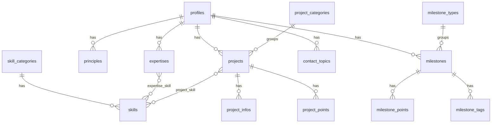

# Portofolio Laravel (tema pantai & laut), database-driven

Seluruh konten profil dibaca dari **database** lewat model Eloquent. View Blade tidak berisi teks profil.

## Instalasi
```bash
composer create-project laravel/laravel portofolio
cd portofolio
# salin semua isi folder ini ke proyek (timpa routes/web.php dan DatabaseSeeder.php)

php artisan migrate --seed     # membuat 16 tabel + mengisi data awal
php artisan serve
```
Buka http://127.0.0.1:8000. Tidak perlu `npm install` (CSS/JS ada di `public/`).
Default Laravel 11+ memakai SQLite. Untuk MySQL, isi `DB_*` di `.env` lalu buat databasenya sebelum `migrate`.

## Mengisi data milik Anda
- Edit `database/data/portfolio.php` (nama, kontak, skill, proyek, pendidikan, organisasi, pencapaian),
  lalu jalankan `php artisan migrate:fresh --seed`.
- Entri "Organisasi" dan "Pencapaian" di file itu hanyalah CONTOH. Ganti dengan data Anda.
- Foto: ganti `public/images/profile.svg` (atau ubah `photo_path`). CV: taruh di `public/cv.pdf`.
- Gambar proyek: isi kolom `image_path` (mis. `images/proyek1.png`).

## Struktur database
| Kebutuhan UTS | Tabel |
|---|---|
| Data diri & kontak | `profiles`, `contact_topics` |
| Skill / keahlian | `skill_categories`, `skills`, `expertises`, `expertise_skill`, `principles` |
| Proyek | `project_categories`, `projects`, `project_infos`, `project_points`, `project_skill` |
| Riwayat pendidikan, pengalaman organisasi, pencapaian | `milestone_types`, `milestones`, `milestone_points`, `milestone_tags` |



## Alur data
`routes/web.php` → `PortfolioController@index` (query Eloquent + eager loading) → `resources/views/portfolio.blade.php`.
Migration: `database/migrations/*_create_portfolio_tables.php`. Model: `app/Models`. Seeder: `database/seeders/PortfolioSeeder.php`.
